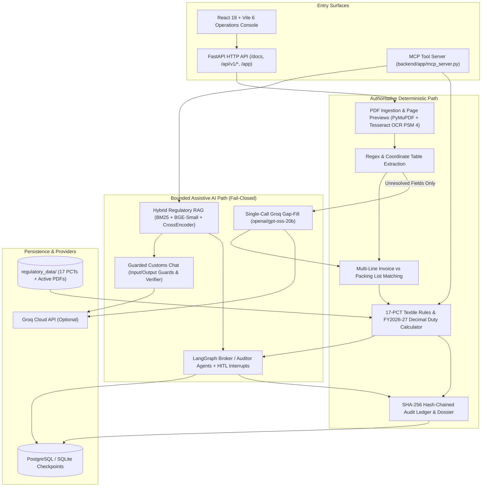

# CACE — Enterprise Customs Engine

[](https://github.com/SayyedainDev/customs-automation-engine/actions/workflows/ci.yml)
[](LICENSE)


Customs & Automated Compliance Engine (CACE) for Pakistan textile export operations. CACE pairs deterministic PDF/OCR parsing, a validated 17-code PCT compliance engine, and exact `Decimal` FY2026–27 cascading customs duty math with bounded LLM gap-fill, hybrid BM25 + dense regulatory retrieval, a resumable LangGraph human-in-the-loop audit workflow, guarded Customs Chat, an MCP tool server, and an Outcome Engineering (`spx`) specification tree.

## Architecture Overview



## Deterministic-First Safety Guarantee

Defined in [`spx/15-authoritative-safety.pdr.md`](spx/15-authoritative-safety.pdr.md):

1. **Authoritative Verdicts Stay Non-LLM**: No language model, agent narration layer, or prompt input can alter deterministic `passed`, `failed`, or `manual_review` compliance status or bypass pending human review. Human corrections mutate structured inputs and recompute status from scratch via a new immutable revision.
2. **Exact Financial Precision**: Cascading FY2026–27 Pakistan customs duties (`DPV = V + CD + ACD + RD + FED`, `Income Tax Base = DPV + ST + VAT`) execute in `Decimal` arithmetic ([`duty_calculator.py`](backend/app/services/compliance/duty_calculator.py)) and refuse resolution when HS/PCT rates are unconfirmed.
3. **Fail-Closed AI Guardrails**: Chat questions and uploaded PDFs pass Unicode-normalized prompt-injection detection, scope routing, SRO citation validation, and numeric grounding verification before outputs reach reviewers ([`pipeline.py`](backend/app/services/customs_chat/pipeline.py)).

## Core Capabilities

1. **Document Ingestion, Page Previews & Provenance**: Digital/scanned PDF ingestion with rendered PNG page previews ([`page_preview.py`](backend/app/services/extraction/page_preview.py)) served through [`documents.py`](backend/app/api/routes/documents.py) and bounding-box highlighting in [`PdfProvenanceViewer.tsx`](frontend/src/components/PdfProvenanceViewer.tsx).
2. **Hybrid Document Extraction (Approaches A / B / C)**: Structural regex/table extractors ([`patterns.py`](backend/app/services/extraction/patterns.py), [`regex_extractor.py`](backend/app/services/extraction/regex_extractor.py)) resolve fields locally at 0 tokens before bounded single-call Groq gap-fill (`openai/gpt-oss-20b`, `extraction_mode="hybrid"`, `ocr_page_segmentation_mode=4` in [`config.py`](backend/app/core/config.py)) across primary and supporting trade documents ([`hybrid_orchestrator.py`](backend/app/services/extraction/hybrid_orchestrator.py), [`supporting_document_hybrid.py`](backend/app/services/extraction/supporting_document_hybrid.py)).
3. **FY2026–27 `Decimal` Duty & Multi-Line Compliance**: Cross-document line alignment, arithmetic checks, and cascading statutory duty computations ([`duty_calculator.py`](backend/app/services/compliance/duty_calculator.py), [`load_tariff_lines.py`](backend/scripts/load_tariff_lines.py), [`multi_line_shipment_service.py`](backend/app/services/multi_line_shipment_service.py)), rendered in [`ComplianceReviewResult.tsx`](frontend/src/components/ComplianceReviewResult.tsx).
4. **LangGraph Customs Audit & Dossier Export**: Stateful `Broker`/`Auditor` workflow with durable PostgreSQL/SQLite interrupts and revision loops ([`graph.py`](backend/app/services/customs_audit/graph.py), [`nodes.py`](backend/app/services/customs_audit/nodes.py), [`workflow_service.py`](backend/app/services/customs_audit/workflow_service.py)) plus downloadable JSON/PDF dossiers ([`dossier.py`](backend/app/services/customs_audit/dossier.py)) inspected in [`AgentAuditResult.tsx`](frontend/src/components/AgentAuditResult.tsx).
5. **Customs AI Assistant & MCP Server**: Grounded multi-stage Q&A pipeline backed by Pakistan tariff and checklist tools ([`pipeline.py`](backend/app/services/customs_chat/pipeline.py), [`tariff_parser.py`](backend/app/services/customs_chat/knowledge/tariff_parser.py), [`checklist_tool.py`](backend/app/services/customs_chat/knowledge/checklist_tool.py)) alongside [`mcp_server.py`](backend/app/mcp_server.py).
6. **React Operations Console**: Vite 6 + React 18 + TypeScript 5.7 console ([`frontend/package.json`](frontend/package.json)) with pages for compliance review ([`NewReviewPage.tsx`](frontend/src/pages/NewReviewPage.tsx)), export preparation ([`PrepareExportPage.tsx`](frontend/src/pages/PrepareExportPage.tsx)), and Customs Chat ([`CustomsChatPage.tsx`](frontend/src/pages/CustomsChatPage.tsx)), mounted directly by [`backend/app/main.py`](backend/app/main.py) at `/app` when built.

## Measured Extraction Benchmark

Evaluated with [`benchmark_extraction.py`](backend/scripts/benchmark_extraction.py) across 32 digital PDFs (476 fields); full methodology and breakdowns live in [`docs/BENCHMARK.md`](docs/BENCHMARK.md).

| Approach | Accuracy / Yield | Tokens Used | Avg Latency / Doc | Operational Notes |
| --- | --- | --- | --- | --- |
| **Approach A (LLM-Only)** | `100.00%` (2 unthrottled `clean_bedsheets` docs); `5.88%` (`28/476`) full-batch yield | `7,187` | `0.328s` | Hit 30 HTTP `429` errors under 8,000 TPM cap |
| **Approach B (Deterministic Regex/Rules)** | `89.50%` (`426/476`) | `0` | `0.006s` | `4/32` documents flagged for manual review |
| **Approach C (Hybrid)** | `89.50%` (`426/476`) | `874` | `0.864s` (on escalated doc) | `31/32` (`96.9%`) resolved locally at 0 tokens; `1/32` escalated; 0 provider failures |

Reproduce offline benchmark verification:

```bash
python backend/scripts/benchmark_extraction.py --verify-offline
```

Supported CLI flags: `--variant {text,scanned,both}`, `--limit`, `--scenario`, `--dry-run`, `--estimate-tokens`, `--verify-offline`, `--no-cache`, `--cache-dir`, `--delay-seconds`, `--output`, and `--write-report`.

## API Routers & MCP Tools

### Registered FastAPI Routers ([`backend/app/main.py`](backend/app/main.py))
- `health` — Service, extraction-cache & customs-audit health endpoints
- `documents` — Document upload, metadata & PDF page preview endpoints
- `structured_extraction` — Single-document hybrid/regex field extraction
- `compliance` — HS validation, FY2026–27 duty calculation & compliance results
- `shipment_extraction` — Shipment-level trade packet extraction
- `multi_line_shipment` — Multi-line commercial invoice & packing list compliance
- `regulatory_evidence` — Supporting SRO and regulatory evidence retrieval
- `compliance_explain` — Structured compliance decision explanations
- `customs_audit` — LangGraph audit workflows, human review & JSON/PDF dossier export
- `shipment_search` — Semantic lookup across finalized shipments
- `assistant` — Export preparation & legacy assistant routes
- `customs_chat` — Multi-turn assistant (`messages`, `conversations/{id}`, `suggestions`, `coverage`, `feedback`)
- `shipments` — Internal compatibility router (`include_in_schema=False`)

Interactive OpenAPI documentation is served at `/docs` and every HTTP response carries `X-Request-ID` and `X-Process-Time-Ms` telemetry headers.

### MCP Server Tools ([`backend/app/mcp_server.py`](backend/app/mcp_server.py))
- `lookup_pakistan_tariff`
- `calculate_pakistan_customs_duties`
- `get_textile_export_checklist`
- `search_pakistan_customs_regulations`

## Quick Start & Verification

### Option A — Docker Compose (PostgreSQL + FastAPI + Built Console)

```bash
docker compose up --build
```

The app starts on `http://localhost:8000` (redirects `/` to `/app/` when `CUSTOMS_SERVE_FRONTEND=true`) with PostgreSQL 16 and LangGraph PostgreSQL checkpointing configured in [`docker-compose.yml`](docker-compose.yml).

To build only the application image standalone:

```bash
docker build -f backend/Dockerfile .
```

### Option B — Local Development

**1. Backend environment & API server** (see [`backend/.env.example`](backend/.env.example) for all flags such as `GROQ_API_KEY` and `REGULATORY_ENABLE_REAL_MODELS`):

```bash
python3.11 -m venv .venv
source .venv/bin/activate
pip install --index-url https://download.pytorch.org/whl/cpu torch
pip install -r backend/requirements-dev.txt
cp backend/.env.example backend/.env
cd backend && uvicorn app.main:app --reload
```

**2. Frontend console** (from `enterprise_customs_engine/`):

```bash
npm --prefix frontend ci
npm --prefix frontend run dev
```

Build and preview the production bundle (`tsc --noEmit && vite build`):

```bash
npm --prefix frontend run build
npm --prefix frontend run preview
```

### Verification Suite (Backend, Spec Tree, Lint & Typecheck)

From `enterprise_customs_engine/` (configured via [`pyproject.toml`](pyproject.toml)):

```bash
pytest -c pyproject.toml
pytest -c pyproject.toml spx -v
ruff check --config pyproject.toml backend/cace_testing spx
mypy --config-file pyproject.toml backend/app
mypy --config-file pyproject.toml backend/cace_testing spx
```

## Outcome Engineering (Spec Tree)

CACE manages specifications and behavioral verification through a native 3.x Spec Tree ([`spx.config.yaml`](spx.config.yaml)) rooted at [`spx/cace.product.md`](spx/cace.product.md):

- **21 Feature/Platform Nodes & 2 Decisions** (`15-authoritative-safety.pdr.md` and `18-architecture-and-evidence.adr.md`) ordered `20` through `80` across ingestion, extraction, RAG retrieval, compliance/duties, LangGraph audit, Customs Chat, and external surfaces.
- **16 Evidence-Tiered Test Suites** (`spx/**/tests/`) executing in-process against real SQLite schemas, FastAPI routers, PyMuPDF rendering, and L2 `npm --prefix frontend run build` using shared harnesses in `backend/cace_testing/` and [`spx/conftest.py`](spx/conftest.py).

Validate specs and check deliverable ordering with `spx`:

```bash
spx config validate
spx validation markdown spx/
spx spec status --format json
spx spec next
```

## Repository Layout

```text
enterprise_customs_engine/
├── .github/workflows/ci.yml     # GitHub Actions CI (frontend, spx, lint, mypy, pytest)
├── backend/
│   ├── app/
│   │   ├── api/routes/          # 13 FastAPI route modules
│   │   ├── core/                # Config, database session & exceptions
│   │   ├── models/              # SQLAlchemy 2.0 ORM models (14 tables)
│   │   ├── schemas/             # Pydantic v2 contracts
│   │   ├── services/            # compliance, customs_audit, customs_chat, extraction, regulatory
│   │   ├── main.py              # FastAPI app, middleware & static /app mount
│   │   └── mcp_server.py        # 4 MCP customs & duty tools
│   ├── cace_testing/            # Shared Spec Tree test harnesses & Hypothesis generators
│   ├── migrations/              # Numbered SQL migrations (001-015)
│   ├── scripts/                 # benchmark_extraction.py, tariff parser/loader, RAG builders
│   ├── tests/                   # Backend unit & integration test suites
│   ├── .env.example             # Full environment reference
│   ├── Dockerfile               # Multi-stage Node 22 + Python 3.11 + Tesseract image
│   ├── requirements.txt         # Runtime dependencies
│   └── requirements-dev.txt     # Test, Hypothesis, ruff & mypy tooling
├── frontend/                    # cace-operations-console (React 18 / Vite 6 / TS 5.7)
├── regulatory_data/             # Active textile PCT rules, curated guidance, 7 runtime & 7 amendment PDFs
├── spx/                         # Outcome Engineering specs (21 nodes, 2 decisions, 16 suites)
├── docs/                        # Architecture, benchmark, project map & archived milestone docs
├── docker-compose.yml           # Local PostgreSQL 16 + CACE stack
├── LICENSE                      # MIT License
├── pyproject.toml               # Unified pytest, ruff, and mypy configuration
└── spx.config.yaml              # Spec Tree 3.x configuration
```

## Documentation Index

- [`docs/BENCHMARK.md`](docs/BENCHMARK.md) — Digital PDF extraction benchmark results (Approaches A, B, and C)
- [`docs/CUSTOMS_CHATBOT_ARCHITECTURE.md`](docs/CUSTOMS_CHATBOT_ARCHITECTURE.md) — Customs AI chatbot design & guardrails architecture
- [`docs/PROJECT_MAP.md`](docs/PROJECT_MAP.md) — Module, database table & API map
- [`docs/PRESENTATION_GUIDE.md`](docs/PRESENTATION_GUIDE.md) — Architecture walkthrough & demo guide
- [`docs/archive/README.md`](docs/archive/README.md) — Archived early-milestone verification & review snapshots
- [`spx/cace.product.md`](spx/cace.product.md) — Outcome Engineering product root specification
- [`spx/15-authoritative-safety.pdr.md`](spx/15-authoritative-safety.pdr.md) — Deterministic compliance & fail-closed AI PDR
- [`spx/18-architecture-and-evidence.adr.md`](spx/18-architecture-and-evidence.adr.md) — Architecture & verification evidence ADR
- [`LICENSE`](LICENSE) — MIT License
