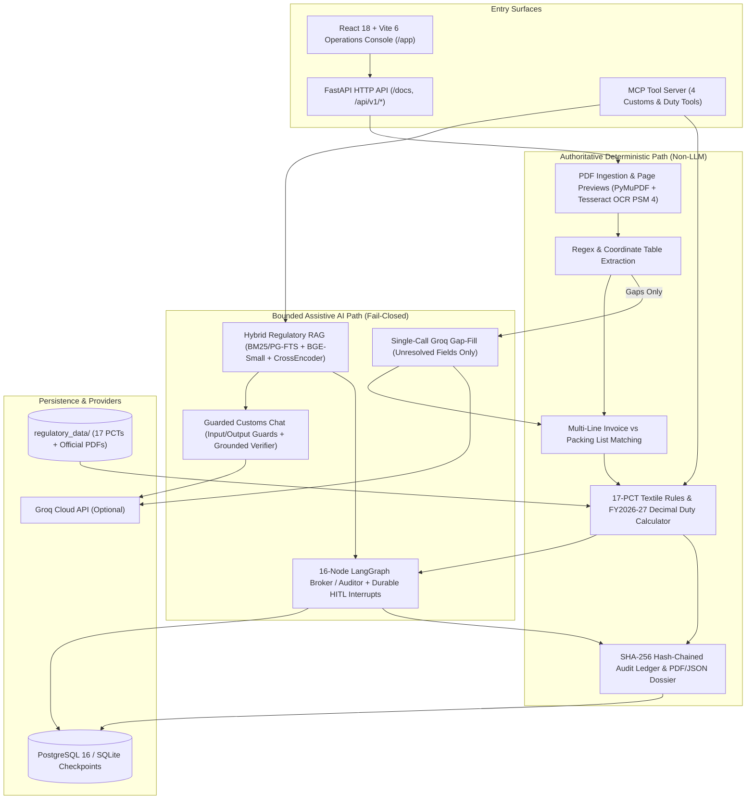

# CACE — Customs & Automated Compliance Engine

[](https://github.com/SayyedainDev/customs-automation-engine/actions/workflows/ci.yml)
[](.github/workflows/ci.yml)
[-blue)](pyproject.toml)
[](LICENSE)


**Deterministic-first, fail-closed AI compliance engine for Pakistan textile export operations.**

Pakistan textile exporters routinely face shipment holds from cross-document quantity/weight mismatches, missing statutory paperwork (Form-E, CPFTA Certificates of Origin, SBP deposits), and miscalculated compounding duties. Pure-LLM document pipelines fail in this domain: they hallucinate compliance verdicts, drift on financial arithmetic, and collapse under real provider rate limits.

**CACE separates authoritative legal computation from assistive AI.** Deterministic coordinate/regex parsers, a validated 17-code PCT compliance engine, and exact `Decimal` FY2026–27 cascading duty math freeze every compliance status in Python. Bounded single-call LLM gap-fill, hybrid BM25 + dense regulatory RAG, a 16-node resumable LangGraph human-in-the-loop (HITL) audit workflow, and guarded Customs Chat operate strictly inside fail-closed boundaries and can never override a deterministic verdict.

---

## Engineering Highlights at a Glance

| Dimension | Measured Result | Evidence |
| --- | --- | --- |
| **Automated Verification** | **1,483 passed**, 0 failed (unit, integration, Hypothesis property, 16 `spx` Spec Tree suites) | [`.github/workflows/ci.yml`](.github/workflows/ci.yml) |
| **Static Quality Gates** | **0 `mypy` errors** across 193 Python files; `ruff` clean; strict `tsc --noEmit && vite build` | [`pyproject.toml`](pyproject.toml) |
| **Hybrid Extraction Efficiency** | **96.9%** (`31/32`) digital PDFs resolved locally at **0 tokens** (`0.004s` median); **87.8% token reduction** vs LLM-only (`7,187 → 874`) with **0** HTTP 429 failures | [`docs/BENCHMARK.md`](docs/BENCHMARK.md) |
| **Authoritative AI Safety** | Non-LLM compliance verdicts, Unicode NFKC/zero-width prompt-injection guards, SRO citation validation, immutable audit revisions, SHA-256 hash-chained audit ledger | [`SECURITY.md`](SECURITY.md), [`spx/15-authoritative-safety.pdr.md`](spx/15-authoritative-safety.pdr.md) |
| **Zero-Key Reproducibility** | Runs full API, console, Docker stack, and entire 1,483-test CI suite with **zero paid API keys** (`GROQ_API_KEY` optional; degraded fallbacks explicitly labelled) | [`docker-compose.yml`](docker-compose.yml) |

---

## Architecture Overview



### End-to-End Request Lifecycle

1. **Ingest & Preview**: PDFs pass bounded upload streaming, root path-containment checks, PyMuPDF extraction, PNG page rendering, and Tesseract OCR fallback (`PSM 4`) for scanned pages.
2. **Hybrid Extraction**: Deterministic regex/coordinate extractors resolve structured header and line-item fields locally first; only genuinely unresolved gaps escalate to a single token-budgeted Groq call.
3. **Deterministic Compliance & Duty Freeze**: Cross-document line alignment, arithmetic checks, 17-code PCT executable rules, supporting document checks, and `Decimal` FY2026–27 cascading duty math compute and freeze Revision 1's authoritative status.
4. **LangGraph Audit, Hybrid RAG & HITL**: A 16-node `StateGraph` pairs independent `Broker` and `Auditor` agents with hybrid regulatory retrieval, durable PostgreSQL/SQLite interrupts, targeted field-correction dependency recomputation (appending immutable Revision `N+1`), and downloadable JSON/PDF dossiers.

---

## Key Engineering Decisions & Trade-offs

1. **Why Deterministic-First + Single-Call Gap-Fill over LLM-Only Extraction?**
   Under Groq's real 8,000 TPM cap, pure-LLM extraction (`Approach A`) failed on 30 of 32 digital PDFs with HTTP `429` errors (`5.88%` batch yield). Running regex/coordinate parsers first (`Approach C`) resolved `31/32` documents locally in `0.004s` median latency at 0 tokens, reserving LLM spend exclusively for unresolved gaps and cutting token usage by `87.8%` with zero provider failures.
2. **Why Freeze Compliance Verdicts Before LangGraph Agents Run?**
   LLMs are strong narrators and poor legal authorities. Freezing the deterministic verdict before the `Auditor` or `Explanation` nodes execute guarantees that prompt-injected PDFs or model hallucinations can never flip `FAILED` or `MANUAL_REVIEW` to `PASSED`. Human reviewers correct structured input fields—never status strings—and Python recomputes a new immutable revision while preserving Revision 1 intact.
3. **Why Hybrid BM25 / PostgreSQL FTS + Cached Vector Matrix over an External Vector DB?**
   Keeping regulatory chunks and embeddings in SQL (`regulatory_chunks` + `regulatory_chunk_vectors`) paired with a collection-isolated, staleness-checked in-memory `VectorMatrix` eliminates an extra stateful cluster while delivering sub-10ms dense scoring. Retrieval enforces exact 8-digit PCT token matching (preventing cross-token digit concatenation), tie-safe competition RRF ranking, cross-encoder reranking, and automatic exclusion of superseded SROs on non-historical queries.
4. **Why `Decimal` Cascading Duty Math & Fail-Closed Guardrails?**
   Pakistan import/landed-cost levies compound across seven stages (`DPV = V + CD + ACD + RD + FED`; `Income Tax Base = DPV + ST + VAT`). Executing exclusively in `Decimal` (`ROUND_HALF_UP`) eliminates binary float drift and returns HTTP `422` whenever an HS code lacks a confirmed statutory rate. Chat and document boundaries apply Unicode NFKC + zero-width stripping against obfuscated prompt injections.

---

## Measured Extraction Benchmark

Evaluated with [`benchmark_extraction.py`](backend/scripts/benchmark_extraction.py) across **32 digital PDFs** (16 scenarios, **476 required fields**) using `openai/gpt-oss-20b` (`temperature=0`, `max_retries=0`) under a real 8,000 TPM limit. Full methodology and per-field error analysis live in [`docs/BENCHMARK.md`](docs/BENCHMARK.md).

| Approach | Batch Accuracy | Silent Error Rate | Safe Abstention (`MANUAL_REVIEW`) | Total Tokens | Median / Avg Latency | Provider Failures |
| --- | :---: | :---: | :---: | :---: | :---: | :---: |
| **A) LLM-Only** (`single-shot Groq`) | `5.88%` (`28/476`)* | `0.00%` | `0.00%` (`448` unflagged missing) | `7,187` | `0.201s` / `0.328s` | `30` (`HTTP 429`) |
| **B) Deterministic-Only** (`regex + coords`) | `89.50%` (`426/476`) | `6.30%` (`30`) | `4.20%` (`20`) | `0` | `0.004s` / `0.006s` | `0` |
| **C) CACE Hybrid** (`regex + 1-call gap-fill`) | `89.50%` (`426/476`) | `6.30%` (`30`) | `4.20%` (`20`) | `874` | `0.004s` / `0.031s` | `0` |

\* *On the 2 unthrottled documents (`clean_bedsheets`, 28 fields) that cleared TPM quota, Approach A achieved `100.00%` vs `92.86%` for B/C.*

**Honest Trade-off Breakdown**: Why did B and C score `89.50%` instead of `100%` on digital PDFs? **27 of the 30 silent errors** were trailing-period normalization differences (`(Pvt.) Ltd.` vs `(Pvt.) Ltd`) scored under strict `.casefold()` equality, while **all 20 remaining misses (`4.20%`) were intentional fail-closed `MANUAL_REVIEW` abstentions** (multi-line weights/package counts withheld rather than guessed). Because coordinate parsing already resolved `31/32` (`96.9%`) clean digital PDFs locally, Hybrid's accuracy advantage appears primarily on noisy/scanned OCR documents rather than clean digital layouts.

Reproduce offline benchmark verification:

```bash
python backend/scripts/benchmark_extraction.py --verify-offline
```

---

## Core Capabilities

1. **Document Ingestion, Page Previews & Provenance**: Bounded PDF uploads, PyMuPDF + Tesseract OCR (`PSM 4`), rendered PNG page previews ([`page_preview.py`](backend/app/services/extraction/page_preview.py)), and bounding-box highlighting in [`PdfProvenanceViewer.tsx`](frontend/src/components/PdfProvenanceViewer.tsx).
2. **Hybrid Primary & Supporting Document Extraction**: Coordinate/regex extractors ([`patterns.py`](backend/app/services/extraction/patterns.py), [`regex_extractor.py`](backend/app/services/extraction/regex_extractor.py)) with bounded Groq gap-fill across commercial invoices, packing lists, Form-E/PSW declarations, Certificates of Origin, L/Cs, and SBP deposit proofs ([`hybrid_orchestrator.py`](backend/app/services/extraction/hybrid_orchestrator.py), [`supporting_document_hybrid.py`](backend/app/services/extraction/supporting_document_hybrid.py)).
3. **FY2026–27 `Decimal` Duty & Multi-Line Compliance**: Cross-document line alignment, arithmetic reconciliation, 17-PCT executable rules, and statutory cascading duty calculations ([`duty_calculator.py`](backend/app/services/compliance/duty_calculator.py), [`multi_line_shipment_service.py`](backend/app/services/multi_line_shipment_service.py)).
4. **16-Node LangGraph Audit Workflow & Dossier Export**: Stateful `Broker`/`Auditor` verification, targeted field-correction dependency recomputation ([`dependency_map.py`](backend/app/services/customs_audit/dependency_map.py)), durable PostgreSQL/SQLite checkpoints ([`graph.py`](backend/app/services/customs_audit/graph.py), [`nodes.py`](backend/app/services/customs_audit/nodes.py)), and downloadable JSON/PDF dossiers ([`dossier.py`](backend/app/services/customs_audit/dossier.py)).
5. **Hybrid Regulatory RAG, Guarded Customs Chat & MCP Server**: Multi-stage RAG retrieval ([`retrieval.py`](backend/app/services/regulatory/retrieval.py)), shipment-scoped document chat ([`shipment_retriever.py`](backend/app/services/assistant/shipment_retriever.py)), guarded Customs Chat with scope routing & groundedness verification ([`pipeline.py`](backend/app/services/customs_chat/pipeline.py)), and 4 MCP tools ([`mcp_server.py`](backend/app/mcp_server.py)).
6. **React Operations Console**: Vite 6 + React 18 + TypeScript 5.7 console ([`frontend/package.json`](frontend/package.json)) covering compliance reviews ([`NewReviewPage.tsx`](frontend/src/pages/NewReviewPage.tsx)), export preparation ([`PrepareExportPage.tsx`](frontend/src/pages/PrepareExportPage.tsx)), and Customs Chat ([`CustomsChatPage.tsx`](frontend/src/pages/CustomsChatPage.tsx)), mounted directly by FastAPI at `/app` when built.

---

## Quick Start & 60-Second API Try-It

### Option A — Docker Compose (Recommended: PostgreSQL 16 + FastAPI + Built Console)

```bash
git clone https://github.com/SayyedainDev/customs-automation-engine.git
cd customs-automation-engine
docker compose up --build
```

Open **`http://localhost:8000/app/`** (Operations Console) or **`http://localhost:8000/docs`** (Interactive OpenAPI docs). Every HTTP response carries `X-Request-ID` and `X-Process-Time-Ms` headers.

### Option B — Local Development (Zero API Keys Required)

```bash
git clone https://github.com/SayyedainDev/customs-automation-engine.git
cd customs-automation-engine

# 1. Backend
python3.11 -m venv .venv
source .venv/bin/activate
pip install --index-url https://download.pytorch.org/whl/cpu torch
pip install -r backend/requirements-dev.txt
cp backend/.env.example backend/.env
cd backend && uvicorn app.main:app --reload

# 2. Frontend console (in a second terminal from the repo root)
npm --prefix frontend ci
npm --prefix frontend run dev
```

### 60-Second API Try-It

Once the server is running on `http://localhost:8000`:

```bash
# Check service health
curl -s http://localhost:8000/health

# Calculate exact FY2026-27 cascading Pakistan customs duties for PCT 6203.4200 (cotton trousers)
curl -s -X POST http://localhost:8000/api/v1/compliance/calculate-duties \
  -H "Content-Type: application/json" \
  -d '{"hs_code": "62034200", "assessed_value": "10000.00"}'
```

### Offline Verification Suite (Matches GitHub Actions CI)

Run the full 1,483-test suite, static typecheck, linter, Spec Tree validation, and frontend build without downloading Hugging Face models or needing external credentials:

```bash
REGULATORY_ENABLE_REAL_MODELS=false LANGGRAPH_CHECKPOINT_BACKEND=memory pytest -c pyproject.toml
ruff check --config pyproject.toml backend/cace_testing spx
mypy --config-file pyproject.toml backend/app
mypy --config-file pyproject.toml backend/cace_testing spx
npx --yes @outcomeeng/spx@0.9.0 config validate
npx --yes @outcomeeng/spx@0.9.0 validation markdown spx/
npm --prefix frontend run build
```

---

## API Surface & MCP Tools

### Registered FastAPI Routers ([`backend/app/main.py`](backend/app/main.py))
- `health` — Service, database, extraction-cache, and customs-audit checkpointer health
- `documents` — Bounded PDF upload, metadata, and PNG page preview endpoints
- `structured_extraction` — Single-document hybrid/regex structured extraction
- `compliance` — Deterministic compliance checks and FY2026–27 `Decimal` duty calculations
- `shipment_extraction` & `multi_line_shipment` — Multi-line invoice vs packing list reconciliation
- `regulatory_evidence` & `compliance_explain` — Hybrid SRO/evidence retrieval and citation-validated explanations
- `customs_audit` — LangGraph HITL workflows, human corrections, and JSON/PDF dossier exports
- `shipment_search` — L2-normalized semantic lookup across finalized shipments
- `assistant` & `customs_chat` — Export preparation, shipment document Q&A, and multi-turn guarded Customs Chat

### MCP Server Tools ([`backend/app/mcp_server.py`](backend/app/mcp_server.py))
- `lookup_pakistan_tariff`
- `calculate_pakistan_customs_duties`
- `get_textile_export_checklist`
- `search_pakistan_customs_regulations`

---

## Outcome Engineering (Spec Tree)

Specifications and behavioral verification are managed through a native `spx` 3.x Spec Tree ([`spx.config.yaml`](spx.config.yaml)) rooted at [`spx/cace.product.md`](spx/cace.product.md):

- **21 Feature/Platform Nodes & 2 Decisions** ([`15-authoritative-safety.pdr.md`](spx/15-authoritative-safety.pdr.md), [`18-architecture-and-evidence.adr.md`](spx/18-architecture-and-evidence.adr.md)) ordered `20`–`80` across ingestion, extraction, RAG retrieval, compliance/duties, LangGraph audit, Customs Chat, and external surfaces.
- **16 Evidence-Tiered Test Suites** (`spx/**/tests/`) executing in-process against real SQLite schemas, FastAPI routers, PyMuPDF rendering, and L2 `npm --prefix frontend run build`.

---

## Scope & Known Limitations

- **Pre-Submission Audit Only**: CACE verifies internal document consistency and configured statutory checklists; it does not grant official FBR/PSW customs clearance or externally authenticate documents with issuing banks/TDAP.
- **Validated PCT Scope**: Deterministic rules cover 17 validated Pakistan textile PCT codes; out-of-scope codes trigger explicit `manual_review` rather than speculative pass/fail rulings.
- **Single-User Prototype Auth**: Multi-tenant authentication and RBAC are intentionally outside the current prototype boundary (documented in [`SECURITY.md`](SECURITY.md)).
- **Synthetic Benchmark Corpus**: Extraction benchmark figures reflect 32 synthetic digital PDFs (`synthetic_factory/`); scanned OCR PDFs (`*_scanned.pdf`) are evaluated separately.

---

## Repository Layout

```text
customs-automation-engine/
├── .github/
│   ├── workflows/ci.yml         # GitHub Actions CI (frontend, spx, ruff, mypy, pytest)
│   ├── ISSUE_TEMPLATE/          # Bug report & feature request templates
│   └── PULL_REQUEST_TEMPLATE.md # PR safety & verification checklist
├── backend/
│   ├── app/
│   │   ├── api/routes/          # 13 FastAPI route modules
│   │   ├── core/                # Config, database session & exceptions
│   │   ├── models/              # SQLAlchemy 2.0 ORM models (14 tables)
│   │   ├── schemas/             # Pydantic v2 contracts
│   │   ├── services/            # compliance, customs_audit, customs_chat, extraction, regulatory
│   │   ├── main.py              # FastAPI app, telemetry middleware & static /app mount
│   │   └── mcp_server.py        # 4 MCP customs & duty tools
│   ├── cace_testing/            # Shared Spec Tree test harnesses & Hypothesis generators
│   ├── migrations/              # Numbered SQL migrations (001–015)
│   ├── scripts/                 # benchmark_extraction.py, tariff loader, RAG index builders
│   ├── tests/                   # Backend unit & integration test suites
│   ├── .env.example             # Complete environment configuration reference
│   ├── Dockerfile               # Multi-stage Node 22 + Python 3.11 + Tesseract image
│   ├── requirements.txt         # Runtime dependencies
│   └── requirements-dev.txt     # Test, Hypothesis, ruff & mypy tooling
├── frontend/                    # cace-operations-console (React 18 / Vite 6 / TS 5.7)
├── regulatory_data/             # Active textile PCT rules, curated guidance & official PDFs
├── spx/                         # Outcome Engineering Spec Tree (21 nodes, 2 decisions, 16 suites)
├── docs/                        # Architecture, benchmark, project map & walkthrough guides
├── docker-compose.yml           # Local PostgreSQL 16 + CACE stack
├── CHANGELOG.md                 # Release history
├── CONTRIBUTING.md              # Local workflow, gates & invariants
├── SECURITY.md                  # Security boundaries, AI guardrails & disclosure policy
├── LICENSE                      # MIT License
├── pyproject.toml               # Unified pytest, ruff & mypy configuration
└── spx.config.yaml              # Spec Tree 3.x configuration
```

## Documentation Index

- [`docs/BENCHMARK.md`](docs/BENCHMARK.md) — Digital PDF extraction benchmark results (Approaches A, B, and C)
- [`docs/CUSTOMS_CHATBOT_ARCHITECTURE.md`](docs/CUSTOMS_CHATBOT_ARCHITECTURE.md) — Customs AI chatbot design & guardrails architecture
- [`docs/PROJECT_MAP.md`](docs/PROJECT_MAP.md) — Module, database table & API map
- [`docs/PRESENTATION_GUIDE.md`](docs/PRESENTATION_GUIDE.md) — Architecture walkthrough & live demo guide
- [`spx/cace.product.md`](spx/cace.product.md) — Outcome Engineering product root specification
- [`spx/15-authoritative-safety.pdr.md`](spx/15-authoritative-safety.pdr.md) — Deterministic compliance & fail-closed AI PDR
- [`spx/18-architecture-and-evidence.adr.md`](spx/18-architecture-and-evidence.adr.md) — Architecture & verification evidence ADR
- [`SECURITY.md`](SECURITY.md) — Security architecture & responsible disclosure
- [`CONTRIBUTING.md`](CONTRIBUTING.md) — Contribution workflow & quality gates
- [`CHANGELOG.md`](CHANGELOG.md) — Version history
- [`LICENSE`](LICENSE) — MIT License
