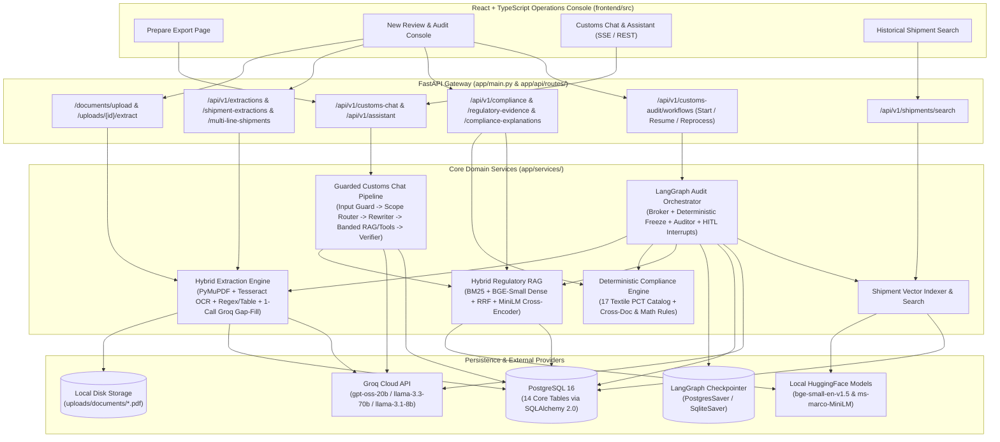
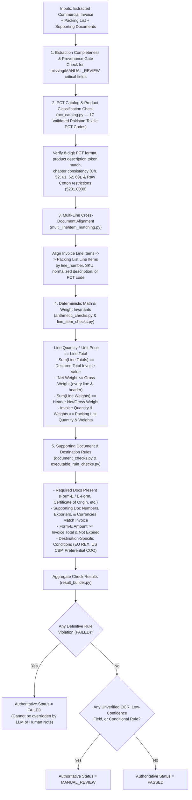
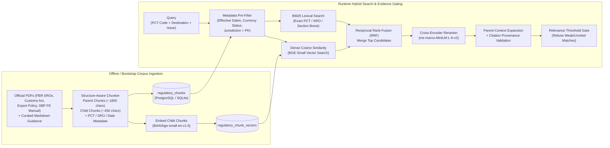
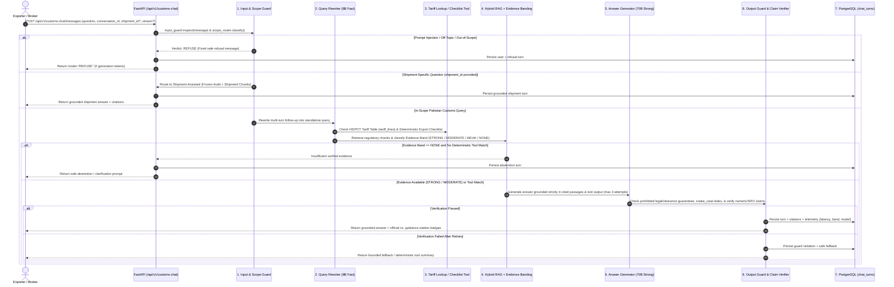

# Enterprise Customs Automation Engine (CACE) — Project Map

## 1. Architecture Overview

**Enterprise Customs Automation Engine (CACE)** is a deterministic-first customs readiness, document-extraction, regulatory RAG, and human-in-the-loop audit platform focused on Pakistan textile exports.

The system is intentionally split into two paths:
1. **Authoritative Deterministic Path**: Local PDF text/coordinate extraction (`PyMuPDF`), conditional OCR (`Tesseract`), regex/table reconstruction, cross-document line-item matching (Commercial Invoice vs. Packing List + Supporting Documents), and deterministic rule execution against a validated catalog of 17 Pakistan Customs Tariff (PCT) textile codes. **Models never decide or alter the compliance verdict (`PASSED`, `FAILED`, or `MANUAL_REVIEW`).**
2. **Assistive AI & Retrieval Path**:
   - **Bounded LLM Gap-Fill**: At most one combined Groq LLM call per document for fields unresolved by deterministic extraction, using small character windows and re-validating all returned values through deterministic field normalizers.
   - **Hybrid Regulatory RAG**: Parent/child chunking of official Pakistan Customs/FBR/Ministry of Commerce/SBP sources + curated guidance, using BM25 lexical search + dense vector embeddings (`BAAI/bge-small-en-v1.5`) + Reciprocal Rank Fusion (RRF) + cross-encoder reranking (`cross-encoder/ms-marco-MiniLM-L-6-v2`).
   - **LangGraph Multi-Agent Customs Audit Workflow**: Resumable graph orchestration with `Broker` and `Auditor` verification roles, durable checkpointing (`SQLite` or `PostgreSQL`), human-review interrupts (`interrupt` / resume), and plain-language explanation generation with strict prohibited-claim and snake-case guards.
   - **Conversational Assistants**: Both a textile-focused assistant (`/api/v1/assistant/*`) and the general **Pakistan Customs Assistant** (`/api/v1/customs-chat/*`) featuring multi-stage scope guards, query rewriting, evidence banding, deterministic checklist/tariff lookup tools, and post-generation claim verification.

```text
+-----------------------------------------------------------------------------------+
|                        React + TypeScript + Vite Frontend                         |
|   Overview | Prepare Export | Document Review | Customs Chat | Shipment Search    |
+-----------------------------------------+-----------------------------------------+
                                          | REST / SSE (/api/v1/*, /documents/*, /health/*)
                                          v
+-----------------------------------------------------------------------------------+
|                              FastAPI Backend (app/main.py)                        |
+-------------------+-------------------+---------------------+---------------------+
| Hybrid Extraction | Compliance Engine | Hybrid RAG & Chat   | LangGraph Audit     |
| - PyMuPDF         | - 17 Textile PCTs | - BM25 + Dense Vec  | - Broker & Auditor  |
| - Tesseract OCR   | - Math & Weights  | - RRF + Reranker    | - Human-in-the-loop |
| - Regex / Tables  | - Cross-Doc Match | - Tariff HS Lookup  | - Audit Event Trail |
| - Groq Gap-Fill   | - Supporting Docs | - Guarded LLM Chat  | - Grounded Narrator |
+-------------------+-------------------+---------------------+---------------------+
                                          |
          +-------------------------------+-------------------------------+
          v                               v                               v
+-------------------+         +-----------------------+       +---------------------+
| PostgreSQL DB     |         | Local SQLite Fallbacks|       | External Providers  |
| (SQLAlchemy 2.0 + |         | - regulatory_index    |       | - Groq Cloud API    |
|  psycopg v3)      |         | - langgraph checkpts  |       | - HF Local Models   |
+-------------------+         +-----------------------+       +---------------------+
```

---

## 2. Workspace Directory & Folder Breakdown

The repository root (`enterprise_customs_engine/`) is organized into focused backend, frontend, regulatory data, test fixture, and documentation modules:

### Top-Level Structure (`enterprise_customs_engine/`)

| Folder / File | Purpose |
| :--- | :--- |
| `backend/` | FastAPI application, business services, SQLAlchemy models, Pydantic schemas, SQL migrations, CLI scripts, and test suites. |
| `frontend/` | React 18 + TypeScript + Vite single-page operations console (`cace-operations-console`). Built assets in `frontend/dist/` can be served directly by FastAPI at `/app`. |
| `regulatory_data/` | Official Pakistan regulatory PDFs (FBR, Ministry of Commerce, SBP, PSW, TDAP, National Assembly), curated markdown guidance, and executable JSON rule configurations. |
| `synthetic_factory/` | Synthetic test bundles (both digital text and scanned PDFs) for commercial invoices, packing lists, and supporting documents, paired with `expected_extraction_and_checks.json` and `scenario_manifest.json`. |
| `docs/` | Architecture specifications, flowcharts, project map (`PROJECT_MAP.md`), phase review notes (`PHASE_1_COMPLIANCE_CODE_REVIEW.md`), and presentation walkthrough (`PRESENTATION_GUIDE.md`). |
| `README.md` | System overview, quick-start instructions, safety guarantees, and operational guide. |

---

### Backend Breakdown (`enterprise_customs_engine/backend/`)

| Folder / Path | Responsibility |
| :--- | :--- |
| `app/main.py` | FastAPI application factory, router registration (13 routers), `/` root handler, and `/app` static frontend mount. |
| `app/mcp_server.py` | Optional Model Context Protocol (`FastMCP`) server exposing deterministic tariff lookup, textile export checklist, and duty-calculation tools. |
| `app/core/` | Core infrastructure: `config.py` (`Settings` via `pydantic-settings`), `database.py` (SQLAlchemy 2.0 engine & session generator), `init_db.py` (table bootstrap), and `exceptions.py` (typed domain and provider exceptions). |
| `app/api/routes/` | FastAPI route modules defining HTTP endpoints, dependency injection (`get_db_session`), and HTTP error mapping. |
| `app/models/` | SQLAlchemy 2.0 declarative ORM models representing the 14 database tables (`documents`, `document_uploads`, `regulatory_chunks`, `regulatory_chunk_vectors`, `customs_audit_workflows`, `customs_human_review_tasks`, `customs_audit_events`, `shipment_summary_vectors`, `shipment_document_chunks`, `assistant_conversations`, `assistant_messages`, `chat_conversations`, `chat_turns`, `tariff_lines`). |
| `app/schemas/` | Pydantic v2 request/response contracts and domain data transfer objects for documents, extraction, OCR, compliance, multi-line matching, regulatory evidence, audit workflows, shipment search, and chat. |
| `app/services/extraction/` | Hybrid extraction pipeline: `pdf_extractor.py` (PyMuPDF text & word coordinates), `ocr_extractor.py` (Tesseract TSV OCR), `regex_extractor.py` & `patterns.py` (deterministic field/table extraction), `llm_gapfill.py` & `groq_gapfill.py` (single-call bounded Groq gap-fill), `supporting_document_hybrid.py` (Form-E, COO, L/C, SBP deposit, phytosanitary extraction), `hybrid_orchestrator.py`, and `cache_fingerprint.py` / `cache_lock.py`. |
| `app/services/compliance/` | Deterministic compliance engine: `pct_catalog.py` (17 supported textile PCT codes), `rule_engine.py`, `rule_loader.py`, `executable_rule_checks.py`, `arithmetic_checks.py`, `document_checks.py`, `document_requirements.py`, `product_checks.py`, `raw_cotton_checks.py`, and `result_builder.py`. |
| `app/services/multi_line/` | Cross-document line-item alignment (`item_matching.py`), line-level arithmetic/weight/PCT checks (`line_item_checks.py`), and canonical field path utilities (`field_paths.py`). |
| `app/services/regulatory/` | Production RAG engine: `ingestion.py` & `chunking.py` (parent/child chunking with provenance), `lexical_index.py` (BM25 lexical search), `embeddings.py` (SentenceTransformers + offline hashing fallback), `vector_store.py` & `vector_cache.py`, `reranker.py` (CrossEncoder + lexical fallback), `retrieval.py` (RRF hybrid search), `citation_validation.py`, `explanation.py`, and `index_db.py`. |
| `app/services/customs_audit/` | LangGraph multi-agent orchestration: `graph.py` & `nodes.py` (state graph definition), `agents.py` (`Broker` & `Auditor` agents + `GroqNarrator`), `consensus.py`, `checkpointer.py` (`PostgresSaver`, `SqliteSaver`, `InMemorySaver`), `explanation.py` (6-heading plain-language explanation with claim guards), `safety.py`, `report.py`, and `workflow_service.py`. |
| `app/services/assistant/` | Textile-focused CACE Assistant: `guidance.py` (pre-submission checklists), `regulatory_chat.py` (guarded corpus Q&A), `shipment_assistant.py` & `shipment_indexer.py` / `shipment_retriever.py` (per-shipment RAG over uploaded documents and audit state), `domain_guard.py`, and `routing.py`. |
| `app/services/customs_chat/` | General Pakistan Customs Assistant: `pipeline.py` (end-to-end turn orchestration), `guards/` (`input_guard.py`, `scope_router.py`, `output_guard.py`, `claims.py`), `understanding/rewriter.py` (conversational query rewriter), `knowledge/` (`retriever.py`, `banding.py`, `checklist_tool.py`, `tariff_lookup.py`, `tariff_parser.py`), `generation/` (`answerer.py`, `verifier.py`, `prompts.py`), `memory/history.py`, and `groq_support.py`. |
| `app/services/shipment_search/` | Historical shipment semantic search: builds text summaries of finalized audit workflows (`summary.py`), embeds and stores vectors (`vector_store.py`), and executes cosine similarity top-k retrieval (`search.py`). |
| `app/services/validation/` | Extraction accuracy evaluation against golden expected fixtures (`extraction_accuracy.py`). |
| `migrations/` | Numbered SQL migration files (`001_add_document_extraction_fields.sql` through `015_add_tariff_lines.sql`) managed by `scripts/apply_migrations.py`. |
| `scripts/` | Operational and evaluation CLI utilities: `apply_migrations.py`, `ingest_regulatory_documents.py`, `build_regulatory_vector_index.py`, `parse_tariff_pdf.py`, `load_tariff_lines.py`, `download_active_export_sros.py`, `run_synthetic_factory_evaluation.py`, `evaluate_production_rag.py`, `groq_quota_preflight.py`, `extraction_coverage_report.py`, etc. |
| `reports/` | Generated markdown and JSON evaluation artifacts (RAG metrics, synthetic factory defect registers, quota probes, supporting document validation runs). |
| `uploads/` | Local filesystem storage directory (`uploads/documents/`) for uploaded PDF and DOCX files. |
| `tests/` | Comprehensive automated test suite (`unit/`, `integration/`, `eval/`, `fixtures/`) covering extraction, compliance rules, adversarial RAG, LangGraph human review, and chat safety guards. |

---

### Frontend Breakdown (`enterprise_customs_engine/frontend/`)

| Folder / Path | Responsibility |
| :--- | :--- |
| `src/main.tsx` & `src/App.tsx` | React application entry point and hash-router configuration (`OverviewPage`, `PrepareExportPage`, `NewReviewPage`, `CustomsChatPage`, `RegulatoryAssistantPage`, `SearchPage`). |
| `src/api/` | Backend HTTP client (`client.ts`) and TypeScript interface definitions (`types.ts`) mirroring FastAPI Pydantic schemas. |
| `src/pages/` | Top-level views for pre-submission export preparation, multi-document compliance review & human-in-the-loop corrections, conversational customs chat (SSE streaming), and historical shipment search. |
| `src/components/` | Reusable UI components: `AppShell.tsx`, `DocumentReviewForm.tsx`, `ComplianceReviewResult.tsx`, `AgentAuditResult.tsx`, `FileDropzone.tsx`, `ProcessingTimeline.tsx`, `StatusBadge.tsx`, etc. |
| `src/hooks/` & `src/state/` | Custom hooks (`useDocumentReview.ts`) and session state context (`SessionContext.tsx`). |
| `src/lib/` | Formatting helpers (`format.ts`) and supporting document metadata utilities (`supportingDocuments.ts`). |

---

### Data & Fixture Folders (`regulatory_data/` & `synthetic_factory/`)

- **`regulatory_data/config/`**: Authoritative JSON rule definitions, including `textile_mvp_pct_codes.json` (the 17 supported PCT codes and product rules) and `legal_effective_dates.json`.
- **`regulatory_data/raw/` & `regulatory_data/processed/`**: Official PDFs and processed text organized by issuing body (`fbr/`, `commerce/`, `ministry_of_finance/`, `national_assembly/`, `psw/`, `tdap/`).
- **`regulatory_data/curated/guidance/`**: YAML-frontmatter Markdown guides for export procedures and document requirements.
- **`synthetic_factory/`**: Scenario directories (`clean_cotton_tshirts/`, `clean_raw_cotton/`, `error_arithmetic_mismatch/`, `error_quantity_mismatch/`, `error_weight_inversion/`, `error_missing_form_e/`, `supporting_documents/*`, etc.) containing digital and scanned PDFs alongside expected check outcomes.

---

## 3. Main FastAPI Routes

All routes are registered in `enterprise_customs_engine/backend/app/main.py`.

### Root & Frontend Mount (`app/main.py`)

| Method | Path | Handler | Description |
| :--- | :--- | :--- | :--- |
| `GET` | `/` | `root` | Redirects (`307`) to `/app/` when `CUSTOMS_SERVE_FRONTEND=true` and `frontend/dist` exists; otherwise returns service status JSON. |
| `GET` | `/app/*` | `StaticFiles` | Serves the built React + Vite frontend bundle when `frontend/dist` is present. |

### Health Checks (`app/api/routes/health.py`)

| Method | Path | Handler | Description |
| :--- | :--- | :--- | :--- |
| `GET` | `/health` | `health_check` | Basic liveness check (`{"status": "ok", "message": "API is running"}`). |
| `GET` | `/health/extraction-cache` | `extraction_cache_health_check` | Returns runtime extraction cache fingerprint and version metadata. |
| `GET` | `/health/customs-audit` | `customs_audit_health_check` | Verifies LangGraph checkpointer initialization, model configuration, and returns a SHA-256 fingerprint of the configured Groq API key. |
| `GET` | `/health/database` | `database_health_check` | Executes `SELECT 1` against PostgreSQL via SQLAlchemy session; returns `503` if unreachable. |

### Documents & Raw Extraction (`app/api/routes/documents.py`)

| Method | Path | Handler | Description |
| :--- | :--- | :--- | :--- |
| `POST` | `/documents/upload` | `upload_document` | Validates and stores an uploaded PDF or DOCX file on disk (`uploads/documents`) and creates a `DocumentUploadRecord` in the database. |
| `GET` | `/documents/uploads/{document_id}` | `get_uploaded_document` | Retrieves metadata and extraction status for an uploaded document by UUID. |
| `POST` | `/documents/uploads/{document_id}/extract` | `extract_document` | Runs PyMuPDF page text/coordinate extraction and conditional Tesseract OCR per page, persisting results to `document_uploads`. |
| `GET` | `/documents/` | `list_documents` | Lists basic `DocumentRecord` rows ordered by integer ID. |
| `POST` | `/documents/` | `create_document` | Creates a metadata-only `DocumentRecord` row. |
| `GET` | `/documents/{document_id}` | `get_document` | Retrieves a `DocumentRecord` by integer ID. |
| `DELETE` | `/documents/{document_id}` | `delete_document` | Deletes a `DocumentRecord` by integer ID. |

### Structured Extraction (`app/api/routes/structured_extraction.py`)

| Method | Path | Handler | Description |
| :--- | :--- | :--- | :--- |
| `POST` | `/api/v1/documents/{document_id}/structured-extraction` | `structured_extraction` | Structures an already-extracted commercial invoice upload into a typed `ExtractedShipment` model and saves it on `document_uploads.structured_data`. |

### Compliance, Multi-Line Extraction & Explanations (`compliance.py`, `shipment_extraction.py`, `multi_line_shipment.py`, `compliance_explain.py`)

| Method | Path | Handler | Description |
| :--- | :--- | :--- | :--- |
| `POST` | `/api/v1/compliance/check` | `check_shipment_compliance` | Runs deterministic Phase 1 compliance rules directly against a structured `ShipmentComplianceInput` payload. |
| `POST` | `/api/v1/compliance/calculate-duties` | `calculate_shipment_duties` | Computes deterministic 2026–27 cascading Pakistan Customs duties and taxes (`CD`, `ACD`, `RD`, `FED`, `Sales Tax`, `VAT`, `AIT`) using exact `decimal.Decimal` arithmetic. |
| `POST` | `/api/v1/compliance/check-documents` | `check_uploaded_shipment_documents` | Extracts a single-line Commercial Invoice + Packing List upload pair, cross-validates fields, and runs deterministic compliance checks. |
| `POST` | `/api/v1/compliance/check-documents/multi-line` | `check_multi_line_shipment_documents` | **Primary extraction & compliance endpoint:** Runs hybrid extraction across multi-line Commercial Invoice, Packing List, and Supporting Documents, aligns line items, and evaluates deterministic compliance rules per item and across the shipment. |
| `POST` | `/api/v1/compliance/explain` | `explain_compliance_decision` | Generates a regulatory-evidence-grounded explanation for a deterministic compliance result without altering the status. |

### Regulatory Evidence Search (`app/api/routes/regulatory_evidence.py`)

| Method | Path | Handler | Description |
| :--- | :--- | :--- | :--- |
| `POST` | `/api/v1/regulatory-evidence/search` | `search_evidence` | Performs hybrid retrieval (BM25 + dense vector + RRF + CrossEncoder reranking) over ingested regulatory chunks; returns `evidence_not_found` if no verified passage passes the relevance gate. |

### LangGraph Customs Audit Workflow (`app/api/routes/customs_audit.py`)

| Method | Path | Handler | Description |
| :--- | :--- | :--- | :--- |
| `POST` | `/api/v1/customs-audit/workflows` | `start_workflow` | Starts a resumable multi-agent LangGraph customs audit workflow over uploaded invoice, packing list, and supporting documents. |
| `GET` | `/api/v1/customs-audit/workflows/{workflow_id}` | `get_workflow_status` | Returns current workflow state, deterministic status, broker/auditor reports, and final report if completed. |
| `GET` | `/api/v1/customs-audit/workflows/{workflow_id}/review` | `get_review_task` | Retrieves the active human-in-the-loop review task (disputed fields, evidence, requested actions) when a workflow is paused at `human_review`. |
| `POST` | `/api/v1/customs-audit/workflows/{workflow_id}/review` | `submit_review` | Submits a human reviewer decision (e.g., field value correction, confirmation, or additional document IDs), recomputes affected deterministic checks, and resumes the LangGraph workflow. |
| `GET` | `/api/v1/customs-audit/workflows/{workflow_id}/events` | `get_audit_events` | Returns the immutable audit event trail (`CustomsAuditEvent` list) with state hashes and actor provenance. |
| `POST` | `/api/v1/customs-audit/workflows/{workflow_id}/retry` | `retry_workflow` | Retries a failed or interrupted audit workflow from its durable checkpoint. |

### Historical Shipment Semantic Search (`app/api/routes/shipment_search.py`)

| Method | Path | Handler | Description |
| :--- | :--- | :--- | :--- |
| `POST` | `/api/v1/shipment-search/search` | `search` | Performs semantic vector search over finalized shipment audit summaries (`shipment_summary_vectors`). |

### CACE Textile & Shipment Assistant (`app/api/routes/assistant.py`)

| Method | Path | Handler | Description |
| :--- | :--- | :--- | :--- |
| `POST` | `/api/v1/assistant/guidance` | `get_guidance` | Generates deterministic pre-submission export checklists and document requirements by product/PCT code and destination. |
| `POST` | `/api/v1/assistant/regulatory/chat` | `post_regulatory_chat` | Answers regulatory questions over the indexed corpus using guarded RAG + deterministic checklist grounding. |
| `GET` | `/api/v1/assistant/supported-products` | `get_supported_products` | Returns the 17 validated textile PCT codes and descriptions from `pct_catalog.py`. |
| `GET` | `/api/v1/assistant/regulatory/scope` | `get_regulatory_scope` | Returns indexed corpus metadata, deterministic compliance scope labels, and suggested starter questions. |
| `POST` | `/api/v1/assistant/shipments/{shipment_id}/chat` | `post_shipment_chat` | Answers questions bound to a specific shipment's extracted documents and frozen audit results (enforces single-shipment conversation isolation). |
| `GET` | `/api/v1/assistant/shipments/{shipment_id}/suggestions` | `get_shipment_suggestions` | Returns starter questions for a specific shipment review session. |
| `GET` | `/api/v1/assistant/conversations/{conversation_id}` | `get_conversation` | Retrieves message history and sources for an `AssistantConversation`. |
| `DELETE` | `/api/v1/assistant/conversations/{conversation_id}` | `delete_conversation` | Deletes an `AssistantConversation` and its messages. |

### General Pakistan Customs Assistant (`app/api/routes/customs_chat.py`)

| Method | Path | Handler | Description |
| :--- | :--- | :--- | :--- |
| `POST` | `/api/v1/customs-chat/messages` | `post_message` | Primary conversational endpoint for the Pakistan Customs Assistant. Supports both Server-Sent Events (`stream: true`, emitting `meta`, `token`, `sources`, `tool_result`, and `done` events) and blocking JSON (`stream: false`). |
| `GET` | `/api/v1/customs-chat/conversations/{conversation_id}` | `get_conversation` | Returns full turn history, evidence bands, and citations for a `ChatConversation`. |
| `GET` | `/api/v1/customs-chat/suggestions` | `get_suggestions` | Returns curated starter prompts for the Customs Assistant UI. |
| `POST` | `/api/v1/customs-chat/feedback` | `post_feedback` | Records user thumbs-up/down rating on a specific `ChatTurn` (`message_id`). |
| `GET` | `/api/v1/customs-chat/coverage` | `get_coverage` | Returns indexed regulatory documents, covered trade directions, corpus snapshot date, and explicitly known corpus gaps. |

### Legacy / Prototype In-Memory Shipments (`app/api/routes/shipments.py`)

| Method | Path | Handler | Description |
| :--- | :--- | :--- | :--- |
| `GET` | `/shipments/` | `list_shipments` | Lists in-memory prototype shipment records (optional `?status_filter=`). |
| `GET` | `/shipments/{shipment_id}` | `get_shipment` | Gets an in-memory shipment record by integer ID. |
| `POST` | `/shipments/` | `create_shipment` | Creates an in-memory shipment record. |
| `PATCH` | `/shipments/{shipment_id}` | `update_shipment` | Partially updates an in-memory shipment record. |
| `DELETE` | `/shipments/{shipment_id}` | `delete_shipment` | Deletes an in-memory shipment record. |
| `POST` | `/shipments/{shipment_id}/validate` | `validate_shipment` | Validates declared invoice value against the sum of line-item totals in memory. |

---

## 4. Database Architecture & Connection Map

### 4.1 Primary Database Connection (`app/core/database.py`)
- **Engine & Driver**: SQLAlchemy `>=2.0,<2.1` using the `psycopg` v3 binary driver (`postgresql+psycopg://...`).
- **Configuration**: Reads `CUSTOMS_DATABASE_URL` (mapped to `Settings.database_url` in `app/core/config.py` with `env_prefix="CUSTOMS_"`).
- **Connection Pooling**: `get_engine()` is `@lru_cache`-cached and creates a SQLAlchemy `Engine` with `pool_pre_ping=True`.
- **FastAPI Request Lifecycle**: `get_db_session()` is a FastAPI dependency (`Depends(get_db_session)`) that creates a `sessionmaker(bind=get_engine(), autoflush=False, expire_on_commit=False)` context per request and guarantees session closure after the request finishes.

### 4.2 Secondary / Fallback Database Connections
1. **Offline Regulatory Index Fallback (`app/services/regulatory/index_db.py`)**:
   - Used by CLI ingestion and evaluation scripts when `CUSTOMS_DATABASE_URL` is not set.
   - Automatically falls back to a local SQLite database at `backend/regulatory_index.sqlite3` (`sqlite+pysqlite:///...`).
   - Note: FastAPI route handlers always use `get_db_session()`.
2. **LangGraph Workflow Checkpointer (`app/services/customs_audit/checkpointer.py`)**:
   - Controlled by `LANGGRAPH_CHECKPOINT_BACKEND` (or `CUSTOMS_LANGGRAPH_CHECKPOINT_BACKEND`):
     - `sqlite` (default for local dev): Uses `langgraph.checkpoint.sqlite.SqliteSaver` connected to `customs_audit_checkpoints.sqlite3`.
     - `postgres` (production): Uses `langgraph.checkpoint.postgres.PostgresSaver` over a dedicated `psycopg.connect(..., autocommit=True, row_factory=dict_row)` connection derived from `CUSTOMS_DATABASE_URL`.
     - `memory` (tests only): Uses `langgraph.checkpoint.memory.InMemorySaver`.

### 4.3 Schema Bootstrap & Migrations
- **Bootstrap (`app/core/init_db.py`)**: Runs `Base.metadata.create_all(bind=get_engine())` to initialize base tables.
- **Migration Runner (`scripts/apply_migrations.py`)**: Applies numbered SQL migrations in `backend/migrations/001_*.sql` through `015_*.sql` in transactional order, tracking applied filenames in the `schema_migrations` table.

### 4.4 ORM Models & Database Tables (`app/models/`)

| Table Name | ORM Model (`app/models/*`) | Purpose |
| :--- | :--- | :--- |
| `documents` | `DocumentRecord` (`documents.py`) | Basic document metadata registry (integer PK). |
| `document_uploads` | `DocumentUploadRecord` (`documents.py`) | Full lifecycle state for uploaded files (UUID PK): file paths, raw extracted text, per-page PyMuPDF coordinates (`extracted_pages`), Tesseract OCR results (`ocr_pages`), structured JSON (`structured_data`), and indexing status. |
| `regulatory_chunks` | `RegulatoryChunk` (`regulatory.py`) | Ingested parent and child regulatory text chunks with full legal provenance (source document, SRO number, page, section, PCT codes, effective/cutoff dates, `source_kind`, `currency_status`). |
| `regulatory_chunk_vectors` | `RegulatoryChunkVector` (`regulatory.py`) | Dense embedding vectors (stored as JSON float arrays) and metadata for child regulatory chunks. |
| `customs_audit_workflows` | `CustomsAuditWorkflow` (`customs_audit.py`) | Queryable projection of LangGraph audit workflows (thread ID, current node, invoice/packing-list UUIDs, frozen `deterministic_status`, `final_report`). |
| `customs_human_review_tasks` | `CustomsHumanReviewTask` (`customs_audit.py`) | Open and resolved human-review interrupt tasks, disputed fields, reviewer decisions, and notes. |
| `customs_audit_events` | `CustomsAuditEvent` (`customs_audit.py`) | Immutable audit log recording every workflow node transition, actor (`system`, `broker`, `auditor`, `human`), and state SHA-256 hashes. |
| `shipment_summary_vectors` | `ShipmentSummaryVector` (`shipment_search.py`) | One dense embedding vector and summary text per finalized `CustomsAuditWorkflow` for historical shipment search. |
| `shipment_document_chunks` | `ShipmentDocumentChunk` (`shipment_chunks.py`) | Parent/child chunks and dense embeddings for individual uploaded shipment documents used by `/api/v1/assistant/shipments/{id}/chat`. |
| `assistant_conversations` | `AssistantConversation` (`assistant.py`) | Conversation sessions for the textile/shipment assistant (`pre_submission_guidance`, `shipment_assistant`, `regulatory_assistant`). |
| `assistant_messages` | `AssistantMessage` (`assistant.py`) | Individual user and assistant messages and source citations for `AssistantConversation`. |
| `chat_conversations` | `ChatConversation` (`customs_chat.py`) | Conversation sessions and rolling summaries for the general Pakistan Customs Assistant. |
| `chat_turns` | `ChatTurn` (`customs_chat.py`) | Per-turn messages plus pipeline telemetry (scope intent, evidence band, token counts, latency, model, prompt version, guard violations, and user feedback). |
| `tariff_lines` | `TariffLine` (`tariff.py`) | Structured Pakistan Customs Tariff table rows (`hs_code`, `description`, `customs_duty_pct`, `unit`, `tariff_year`, `source_page`, `needs_review`) for exact/prefix HS-code lookups. |

---

## 5. Third-Party APIs, LLMs, ML Models & External Tools

### 5.1 Groq Cloud API (`groq` Python SDK)
Groq is the sole external LLM inference provider used across the workspace (configured via `GROQ_API_KEY`). All Groq clients enforce `max_retries=0` to prevent silent quota exhaustion cascades on HTTP 429 rate limits, and classify errors into `StructuredExtractionRateLimitedError`, `StructuredExtractionAuthError`, `StructuredExtractionProviderUnavailableError`, and `StructuredExtractionProviderError`.

| Subsystem | Config / Env Alias | Default Model | How It Is Used |
| :--- | :--- | :--- | :--- |
| **Hybrid Extraction Gap-Fill** (`groq_gapfill.py`, `supporting_document_hybrid.py`, `structured_extraction_service.py`) | `CUSTOMS_GROQ_MODEL` | `openai/gpt-oss-20b` | Makes at most **one** strict JSON-schema (`json_schema` / `json_object`) call per document at `temperature=0` to resolve fields missed by deterministic regex/table parsing. Output is re-validated through `FIELD_NORMALISERS`. |
| **LangGraph Audit Explanation & Narration** (`customs_audit/agents.py`, `customs_audit/explanation.py`) | `LANGGRAPH_EXPLANATION_MODEL`, `LANGGRAPH_BROKER_MODEL`, `LANGGRAPH_AUDITOR_MODEL` | Falls back to `CUSTOMS_GROQ_MODEL` (`openai/gpt-oss-20b`) | `GroqNarrator` generates plain-language 6-heading audit explanations (and optional Broker/Auditor prose when `LANGGRAPH_ENABLE_LIVE_AGENTS=true`) from frozen deterministic findings. Output is checked against prohibited legal claims and raw snake_case identifiers; falls back to a deterministic template on failure. |
| **Textile Regulatory Chat** (`assistant/regulatory_chat.py`) | `CUSTOMS_GROQ_MODEL` | `openai/gpt-oss-20b` | Generates grounded prose explanations over retrieved regulatory evidence and deterministic checklists, falling back to deterministic templates if validation fails. |
| **Pakistan Customs Assistant — Fast Model** (`customs_chat/groq_support.py`) | `CUSTOMS_CHAT_FAST_MODEL` | `llama-3.1-8b-instant` | Used in JSON mode for LLM scope classification (`guards/scope_router.py`), multi-turn conversational query rewriting (`understanding/rewriter.py`), and post-generation claim verification (`generation/verifier.py`). |
| **Pakistan Customs Assistant — Strong Model** (`customs_chat/generation/answerer.py`) | `CUSTOMS_CHAT_STRONG_MODEL` | `llama-3.3-70b-versatile` | Generates the user-facing customs assistant answer grounded in banded regulatory evidence and deterministic tool outputs (tariff lookup & export checklist). |

### 5.2 Hugging Face Local ML Models (`sentence-transformers`)
Loaded locally in-process (on `cpu` by default, controlled by `REGULATORY_ENABLE_REAL_MODELS=true`). No external Hugging Face inference API is called at runtime. When `REGULATORY_ENABLE_REAL_MODELS=false` or model weights are unavailable offline, the system automatically switches to explicitly labelled deterministic fallbacks (`degraded=True`):
- **Dense Embedding Model (`app/services/regulatory/embeddings.py`)**:
  - **Model**: `BAAI/bge-small-en-v1.5` (configurable via `REGULATORY_EMBEDDING_MODEL`).
  - **Used For**: Embedding regulatory child chunks, shipment document chunks, and historical shipment summaries.
  - **Offline Fallback**: `HashingEmbeddingProvider` (256-dim feature-hashed bag of word/character n-grams using BLAKE2b).
- **Cross-Encoder Reranker (`app/services/regulatory/reranker.py`)**:
  - **Model**: `cross-encoder/ms-marco-MiniLM-L-6-v2` (configurable via `REGULATORY_RERANKER_MODEL`).
  - **Used For**: Reranking top-N candidate chunks produced by Reciprocal Rank Fusion (BM25 + dense vector retrieval).
  - **Offline Fallback**: `LexicalReranker` (token overlap with exact PCT code and SRO number boosts).

### 5.3 Document Processing & OCR Engines
- **PyMuPDF (`pymupdf` / `fitz`)**: Primary local PDF parser (`app/services/extraction/pdf_extractor.py`) used to extract embedded text layers, word-level bounding-box coordinates for table reconstruction, and PNG page rasterization (300 DPI) when OCR is needed.
- **Tesseract OCR (`tesseract` CLI binary)**: Invoked via `subprocess.run` (`app/services/extraction/ocr_extractor.py`) with `--psm 4` ("single column of text of variable sizes") and `tsv` output when a PDF page lacks a usable text layer. Computes word-level mean confidence and flags pages below `ocr_min_confidence` (`0.80`) as `MANUAL_REVIEW`.

### 5.4 Workflow Orchestration & Data Libraries
- **LangGraph (`langgraph`, `langgraph-checkpoint-sqlite`, `langgraph-checkpoint-postgres`)**: Drives the stateful multi-agent customs audit graph (`app/services/customs_audit/graph.py`), managing node transitions, conditional human-review interrupts, state checkpointing, and resumption.
- **Scikit-Learn & NumPy (`scikit-learn`, `numpy`)**: Used in TF-IDF/BM25 lexical search, evaluation scripts, and vector similarity calculations (legacy `langchain-community` PDF loading was replaced with single-pass native `pymupdf`).

### 5.5 External Web Scraping / Data Acquisition (Offline CLI Script Only)
- **Federal Board of Revenue (FBR) Export SRO Scraper (`backend/scripts/download_active_export_sros.py`)**:
  - Uses `httpx` and `BeautifulSoup` (`beautifulsoup4`) to inspect `https://www.fbr.gov.pk/ActiveSrosExport` and download official export SRO PDFs from `download1.fbr.gov.pk` into `regulatory_data/raw/fbr/export_sros/`.
  - Runs strictly as an operator-invoked CLI script (dry-run by default); the runtime FastAPI server makes no outbound calls to government websites or WeBOC.


---

## 6. Detailed System Flow Diagrams

### 6.1 End-to-End System Architecture & Request Routing



---

### 6.2 Document Upload & Hybrid Extraction Pipeline

```mermaid
flowchart TD
    A["POST /documents/upload\n(Multipart PDF / DOCX)"] --> B["Validate Magic Bytes (%PDF- or PK ZIP)\n& Enforce 10 MB Limit"]
    B --> C["Write UUID Filename to Disk\n(uploads/documents/)"]
    C --> D["Insert DocumentUploadRecord\n(status = 'uploaded') in PostgreSQL"]

    D --> E["POST /documents/uploads/{id}/extract\nor Triggered by Structured Extraction"]
    E --> F["Commit status = 'extracting' to PostgreSQL"]
    F --> G["Single-Pass PyMuPDF Open\n(pdf_extractor.extract_text_from_pdf)"]
    G --> H["Extract Per-Page Embedded Text\n+ Word Bounding-Box Tuples (x0,y0,x1,y1,word)"]
    H --> I["Commit status = 'extracted'\n(extracted_text + extracted_pages JSONB)"]

    I --> J["Build DocumentTextBundle\n(document_bundle.ensure_pdf_text)"]
    J --> K{"Does Each Page Have\n>= 20 Alphanumeric Chars?"}
    K -- "Yes (Digital PDF)" --> M["Use Embedded PDF Text\n+ PyMuPDF Word Coordinates"]
    K -- "No (Scanned / Raster Page)" --> L["Run Tesseract OCR (300 DPI PNG, --psm 4)\n(ocr_extractor.ocr_pdf_page)"]
    L --> L1{"OCR Mean Confidence\n>= 0.80?"}
    L1 -- "Yes" --> M1["Mark Page OcrValidationStatus.VERIFIED\nPersist to document_uploads.ocr_pages"]
    L1 -- "No" --> M2["Mark Page MANUAL_REVIEW / FAILED\n(Downstream Fields Gated)"]
    M1 --> N
    M2 --> N
    M --> N

    N["Cache Check: Compute Input Fingerprint\n(SHA-256 of Text + Extractor Version + Mode)"] --> O{"Valid Cached JSON in\ndocument_uploads.structured_data?"}
    O -- "Cache Hit" --> Z["Return Validated Structured Document"]
    O -- "Cache Miss" --> P["Stage 1: Deterministic Regex & Coordinate Table Parser\n(regex_extractor.py / supporting_document_hybrid.py)"]

    P --> Q{"All Required Fields Resolved\nwith High Confidence?"}
    Q -- "Yes (0 LLM Tokens)" --> T["Materialize Provenance & Confidence Gate\n(document_bundle.materialize_field)"]
    Q -- "No (Missing Fields & EXTRACTION_MODE=hybrid)" --> R["Stage 2: Bounded Single-Call Groq Gap-Fill\n(groq_gapfill.py — 1 Call Max, Temp=0, Strict JSON)"]
    R --> S["Re-Validate LLM Candidates via Deterministic\nFIELD_NORMALISERS (PCT, Dates, Numbers, Currency)"]
    S --> T

    T --> U{"Source Page Valid &\nConfidence >= 0.80 &\nOCR Verified?"}
    U -- "Yes" --> V["Field Status = VERIFIED"]
    U -- "No" --> W["Null Out Untrusted Value &\nRoute Field to MANUAL_REVIEW"]
    V --> X["Persist to document_uploads.structured_data\n& Index Chunks for Shipment Assistant"]
    W --> X
    X --> Z
```



---

### 6.3 Deterministic Compliance Engine & Cross-Document Verification



---

### 6.4 LangGraph Multi-Agent Customs Audit & Human-in-the-Loop State Machine

```mermaid
flowchart TD
    START(("START")) --> N1["1. load_shipment_documents\nExtract/load Invoice, Packing List, & Supporting Docs"]
    N1 --> N2["2. broker_agent\nInspect extraction provenance, missing fields, & doc preparedness"]
    N2 --> N3["3. deterministic_compliance\nRun Python Compliance Engine & FREEZE Revision 1 Status"]
    N3 --> N4["4. auditor_agent\nRetrieve Regulatory RAG Evidence & Independently Verify Checks"]
    N4 --> N5["5. compare_agent_reports\nEvaluate Broker vs. Auditor Consensus & Anomaly Flags"]

    N5 --> C1{"route_after_compare:\nDisagreement, Uncertainty,\nor MANUAL_REVIEW?"}
    C1 -- "No (Clean Consensus)" --> N14["14. build_final_report\nAssemble Frozen Status + Findings + Citations"]

    C1 -- "Yes (Needs Human Review)" --> N6["6. prepare_human_review\nCreate CustomsHumanReviewTask in PostgreSQL"]
    N6 --> N7[["7. interrupt_for_human_review\nLangGraph interrupt() — Pause & Checkpoint State"]]

    N7 -. "POST /api/v1/customs-audit/workflows/{workflow_id}/review\n(Reviewer Submits Decision)" .-> N8["8. human_decision_received\nRecord Reviewer Action & Audit Event"]

    N8 --> C2{"route_human_action:\nWhat kind of decision?"}
    C2 -- "accept / reject / note /\nprovide_document / reprocess" --> N9["9. resume_workflow\nAttach Reviewer Resolution"]
    N9 --> N14

    C2 -- "confirm_extracted_value /\ncorrect_extracted_value" --> N10["10. apply_human_correction\nValidate Field Path & Re-Run Deterministic Python Engine"]
    N10 --> C3{"Correction Validated\n& Applied?"}
    C3 -- "Validation Failed" --> N14
    C3 -- "Applied" --> N11["11. freeze_corrected_revision\nAppend New Immutable AuditRevision (Rev 2, 3...)"]
    N11 --> N12["12. auditor_recheck_revision\nRe-run Broker & Auditor Observation on New Revision"]
    N12 --> N13["13. recompute_consensus_after_correction"]

    N13 --> C4{"Still Uncertain &\nReview Rounds Remaining?"}
    C4 -- "Yes (Loop Back)" --> N6
    C4 -- "No (Resolved / Max Rounds)" --> N14

    N14 --> N15["15. generate_explanation\n1 Groq Call (6-Heading Narrative) + Prohibited-Claim Guard\n(Deterministic Template Fallback on Failure)"]
    N15 --> N16["16. persist_audit_record\nSave Final Report to PostgreSQL & Index Shipment Summary Vector"]
    N16 --> END_NODE(("END"))
```



---

### 6.5 Hybrid Regulatory RAG Pipeline (Ingestion & Retrieval)



---

### 6.6 Guarded Pakistan Customs Assistant (`customs_chat`) Sequence Flow


